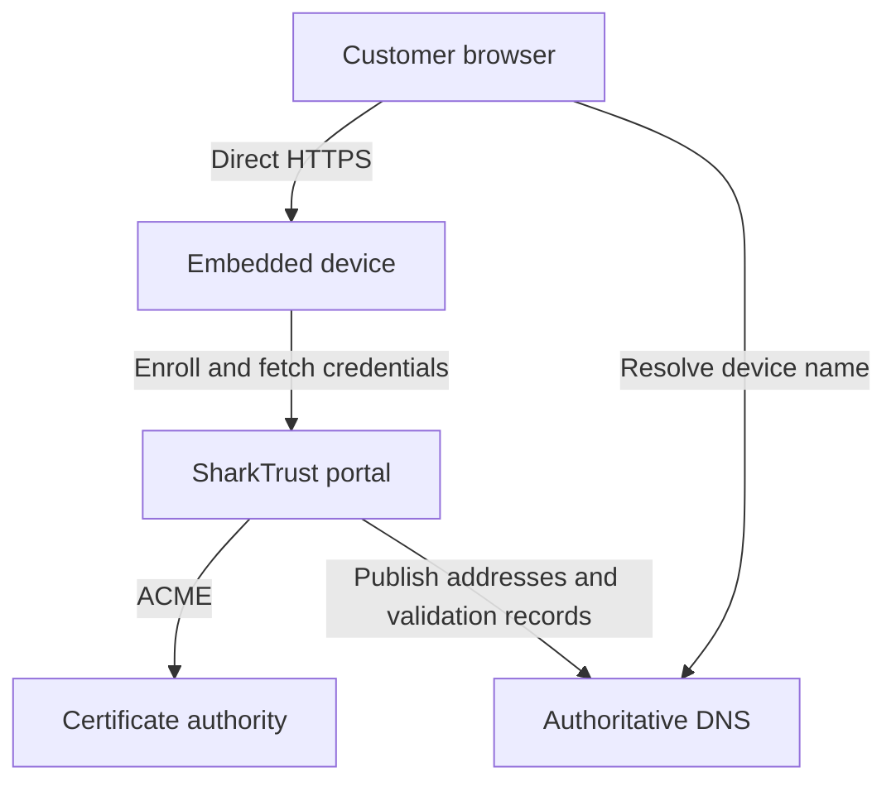

# SharkTrust

## Trusted HTTPS for embedded web interfaces

SharkTrust gives connected products a stable Domain Name System (DNS) name and
automatically managed Transport Layer Security (TLS) certificates, so customers
can open a device's web interface using ordinary HTTPS.
With a publicly trusted certificate authority, users can connect by name without
installing a private root certificate or accepting a self-signed certificate warning.
The device can remain on a private network, with its web interface accessible only
where that network permits.

For a device manufacturer, this removes certificate enrollment and renewal from
the customer's setup procedure. Integrate the SharkTrust client and a zone
credential into your product, and the device can register its address, obtain its
name, and download its certificate and private key. The portal handles the
certificate authority's Automated Certificate Management Environment (ACME)
protocol; the embedded client uses a small binary protocol over TLS.

**Start here:** [Try the C examples](examples/README.md#try-the-shared-test-zone),
[read the user manual](doc/user-guide.md), or
[install your own portal with Ansible](doc/installation.md).


## From a device on the network to a trusted web interface

Consider a product whose web server receives `192.168.1.50` from the customer's
router. SharkTrust can give it a name such as `controller.devices.example.com`
and publish that name with the private address. A browser on a network that can
reach the device opens `https://controller.devices.example.com`. DNS provides
the address, and the certificate authenticates the name.

When the address changes, the client reports the new address. When the
certificate needs renewal, the portal obtains a replacement and the client
fetches and installs it. Customers can find device links on the zone's web page
instead of keeping track of changing IP addresses.



The browser-to-device connection goes directly to the embedded web server.
SharkTrust supplies DNS and certificates; network routing and device access
control remain part of your product and deployment. This portal does not provide
a reverse connection or remote-access tunnel.

## What this gives your product

- **Less customer setup.** Provision a zone credential in firmware so each device
  can register without asking the customer to manage certificates or DNS records.
- **Names that follow devices.** Devices report address changes while retaining
  their registration and assigned name, including when they use DHCP.
- **A smaller client integration.** Keep ACME account management, validation, and
  renewal in the portal. Use the OpenSSL example with an existing web server or
  the SharkSSL/Minnow example as a starting point for an embedded HTTPS server.
- **Your own namespace.** Use a product zone such as `devices.example.com`, or let
  customers register and manage their own zones. One portal can manage multiple
  zones with separate owners and device registrations.
- **Control over deployment.** Run your own portal on a public Linux server or
  on premises, using the supplied Ansible installer and systemd service.
- **Certificate lifecycle management.** The portal uses ACME Renewal Information
  (ARI) when offered by the CA, with a fallback based on actual certificate
  lifetime. Clients still need to fetch and install renewed credentials.
- **Tools for daily administration.** Manage zone users and roles, optionally use
  Microsoft Entra sign-in, review certificate retries, and preview inactive
  devices before removing them.

## Choose the deployment that fits your customers

| Deployment | Useful when | What to plan |
| --- | --- | --- |
| Public portal | Devices at multiple customer sites should share your product's enrollment service. | A public domain, reachable authoritative DNS, portal HTTPS, and outbound device access to the portal. Device web servers can stay private. |
| On-premises portal | A customer wants local control of the portal, device records, and DNS service. | Local DNS resolution and HTTPS trust, plus public delegation and CA access when using a public CA. See the [on-premises guide](doc/on-premises.md). |

SharkTrust defaults to Let's Encrypt and can use another
[compatible ACME CA](doc/portal.md#select-another-certificate-authority).
Public trust depends on the selected CA being trusted by the browser. A private
CA requires its trust root on the computers and devices that rely on it.
Installing the portal on premises does not by itself make public certificate
issuance work offline.

The portal generates and stores device private keys and delivers them over TLS.
Choose SharkTrust when that centralized key model fits your product. Protect
the portal, backups, enrollment credentials, and device storage accordingly.
For a different integration model, see
[SharkTrustX](https://github.com/RealTimeLogic/SharkTrustX), which lets its device
clients perform ACME and keep their certificate private keys on the device.
The two portals use different client protocols.

## Try it before installing a portal

The [examples](examples/README.md) include a public test credential for the
`st.sharkssl.com` device zone. They connect to
`sharktrust.realtimelogic.com`; no zone registration is required for this test.
From a POSIX shell with a C compiler, Make, and OpenSSL development libraries:

```sh
# Run from a checkout of this repository.
cd examples
make
./SharkTrust-Client-Obfuscated-Key
```

The client registers a device and saves its downloaded certificate and key.
Follow the [client guide](examples/README.md) to use them with your web server,
poll for renewals, or replace the bundled `getzkey.ch` with your own zone's file.
The shared test credential is intentionally public; use your own zone for your
product's namespace and credential control.

## Documentation

The [manual index](doc/README.md) provides reading paths for product developers,
zone owners, and portal operators. Each chapter is also linked here:

| Guide | Contents |
| --- | --- |
| [User manual](doc/user-guide.md) | Delegate and register a zone, find devices, obtain client credentials, manage users, and recover access. |
| [Installation with Ansible](doc/installation.md) | Prepare DNS and a Linux server, configure the controller, install, set administrator credentials, and verify the service. |
| [On-premises installations](doc/on-premises.md) | LAN addressing, public DNS validation, local resolvers, and HTTPS bootstrap. |
| [Portal configuration](doc/portal.md) | Installer variables, runtime settings, CA selection, and administrator credentials. |
| [Operations and upgrades](doc/operations.md) | Service commands, renewal behavior, backups, updates, migration, and branding. |
| [Troubleshooting](doc/troubleshooting.md) | DNS delegation, certificate warnings, email errors, client enrollment, and service failures. |
| [Architecture](doc/architecture.md) | DNS and certificate flows, runtime components, key ownership, and security boundaries. |
| [Device protocol](doc/SharkTrust-Protocol.md) | TLS transport, commands, binary responses, credentials, and client lifecycle. |
| [Stored data](doc/data-structures.md) | SQLite records, certificate profiles, renewal schedules, and legacy data import. |
| [C client integration](examples/README.md) | Build and adapt the OpenSSL and SharkSSL/Minnow examples. |

## Source and support

The portal application is in [www](www), the clients are in [examples](examples),
and deployment automation is in [ansible](ansible/README.md). The portal runs on
[Mako Server](https://makoserver.net/) and uses BIND9 for authoritative DNS.

This repository is distributed under the [MIT License](LICENSE). Mako Server and
the TLS libraries used by your device have their own licensing terms. See the
[SharkTrust product page](https://realtimelogic.com/services/SharkTrust/) or
[contact Real Time Logic](https://realtimelogic.com/contactus/) for product
integration and deployment assistance.
