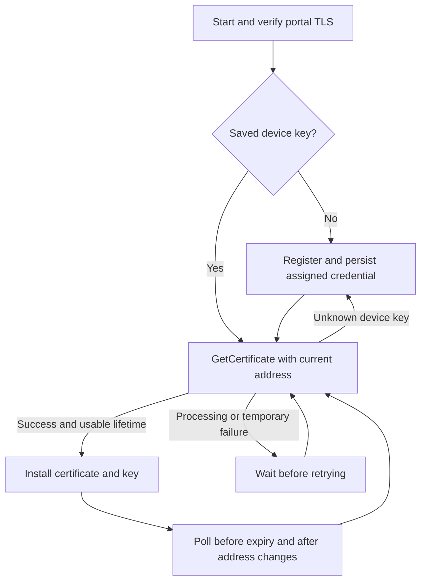

# SharkTrust device protocol

[Manual index](README.md) | [Architecture](architecture.md) | [C examples](../examples/README.md)

This reference describes the binary protocol implemented by
[the portal](../www/.preload) and [the device endpoint](../www/device/index.lsp).
It is for clients that download certificates and private keys from SharkTrust.
SharkTrustX uses a different protocol and credential format.

## Transport and endpoint

Connect to the portal's TLS port 443, verify its certificate chain, hostname,
and validity, then send an HTTP request to `/device/`. The default example
endpoint is `https://sharktrust.realtimelogic.com/device/`.
Use TLS Server Name Indication (SNI) and an HTTP `Host` header matching that
hostname. The portal rejects device commands over an unencrypted connection.

Requests carry command parameters in HTTP headers; the C examples send
`GET /device/ HTTP/1.0` with no body. Header lines end with CRLF and a blank
line terminates the request. By default the response starts directly with the
binary header, **without an HTTP status line or HTTP headers**. The portal
closes the connection after one response.

This allows a small client to write a request over a TLS socket and parse a
compact reply without implementing a complete HTTP response parser. TCP/TLS
reads can split fields or combine them: collect enough bytes before decoding
each field and reject truncated or oversized payloads.

### Optional HTTP response wrapper

Set `X-Response: HTTP-BIN` to request a standard HTTP response with status
`202` and content type `application/octet-stream`, followed by the binary body.
Use an HTTP client to decode the HTTP framing in this mode. The binary status
byte carries the command result; HTTP `202` alone does not mean the command
succeeded. Requests rejected before protocol dispatch can return ordinary
HTTP errors, including `404` when `X-Key` is absent.

## Credentials and common headers

| Header | Type and requirement | Meaning |
| --- | --- | --- |
| `Host` | Required hostname string | Portal hostname used for this TLS connection. |
| `X-Key` | Required string, exactly 64 hexadecimal characters | Zone credential provisioned in the device. Transmit the credential as supplied. |
| `X-Command` | Required case-sensitive string | One of the five commands below. |
| `X-Dev` | String, exactly 20 hexadecimal characters | Required for existing-device operations; returned by `Register`. Transmit it as supplied. |
| `X-Response` | Optional string; absent by default | Only `HTTP-BIN` enables HTTP response framing. Otherwise the reply is raw binary over TLS. |

The zone key authorizes registration in one zone. The device key is a separate
credential, not the TLS private key. Persist it securely before treating a device
as registered. Copying one device key to several devices makes them share the
same registration and address updates.

## Binary response header

Every binary response starts with four bytes:

| Offset | Size | Value |
| --- | --- | --- |
| 0 | 1 byte | `0xFF` |
| 1 | 1 byte | `0x55` |
| 2 | 1 byte | Unsigned status code below. |
| 3 | 1 byte | Reserved; currently zero. Clients must ignore it. |

All multibyte integers are unsigned and use **network byte order (big-endian)**.
Lengths count bytes. Text and PEM fields have **no terminating NUL byte** on
the wire. Add your own terminator if a C string API needs one.

| Code | Name | Meaning and client action |
| --- | --- | --- |
| `0` | Success | Parse the command-specific payload. |
| `1` | Forbidden | Invalid/unknown zone credential, or a device that does not belong to that zone. Check provisioning; repeatedly registering does not fix it. |
| `2` | Unknown | A syntactically valid device key no longer identifies a device. Register again, then save the new credential. |
| `3` | Processing | No certificate/key pair is available yet. Retry the certificate request after a delay; the examples use 70 seconds. |
| `4` | ServerError | A server-side operation failed or the service is not ready. Retry with backoff and investigate persistent failures. |
| `5` | ClientError | Missing/invalid parameters or an unknown command. Correct the request. A malformed `X-Dev` is a client error, not `Unknown`. |

Nonzero responses contain only this four-byte header. Do not parse success
fields from them. If the magic bytes are absent, treat the reply as unexpected
data; it can be an HTTP error or an intermediary's response.

## Address publication

`Register`, `SetIpAddress`, and `GetCertificate` require `X-IpAddress` and accept
`X-Dns`:

| Header | Type and default | Meaning |
| --- | --- | --- |
| `X-IpAddress` | Required dotted-decimal IPv4 string | Device address reachable from its intended users. Four decimal octets, 0-255; no leading zeroes except a single `0`. |
| `X-Dns` | Optional string; `local` | `local` publishes the reported IPv4 address as A; `wan` publishes the connection peer as A or AAAA; `both` publishes both. Other values are currently treated as `local`; send only the documented values. |

Address operations also save the connection's observed source address and update
the device's last-contact time. Send the intended DNS mode on every address or
certificate request; omitting it selects `local` again. WAN or `both` modes
require suitable routing/port forwarding; they do not create remote access.

## Register

Send `X-Command: Register`, `X-Key`, and `X-IpAddress`. There is no existing
device key for this operation.

| Additional header | Type and default | Meaning |
| --- | --- | --- |
| `X-Name` | Optional string; `device` | Requested label, 1-63 letters, digits, or hyphens, without a leading/trailing hyphen. Converted to lowercase. A full name is also accepted when its suffix is exactly the registered zone. |
| `X-Info` | Optional string; empty | Device description; the portal stores at most the first 40 bytes. Use short display text without HTTP line breaks. |

The portal allocates a new device key and unique name. When the requested label
is already registered, it appends a numeric suffix, such as `device1`. The
final label must fit in 63 bytes and the full name in 253 bytes; leave room for
a suffix. Use the returned name instead of assuming your request was accepted
unchanged. A product serial number can provide a useful initial label.

Success payload after the four-byte header:

| Size | Value |
| --- | --- |
| 20 bytes | Device key as hexadecimal ASCII, for subsequent `X-Dev` headers. |
| 2 bytes | Assigned label length `N`. |
| `N` bytes | Assigned device label, without the zone suffix or NUL terminator. |

Registration commits before the success reply. DNS publication and certificate
issuance follow it. A lost reply can leave a registration whose key the device
never received; a repeated `Register` creates another registration rather than
recovering the first. Retain credentials across restarts to avoid repeated
enrollment and unnecessary certificate orders.

## GetCertificate

Send `X-Command: GetCertificate`, `X-Key`, `X-Dev`, `X-IpAddress`, and
`X-CertType`. Optional `X-Dns` has the same behavior as above. This operation
updates the address and returns the currently stored certificate/key pair.
It does not wait for an ACME order to finish.

| Header | Type and requirement | Meaning |
| --- | --- | --- |
| `X-CertType` | Required case-sensitive string | Use `X509` for PEM data or `Shark` for a combined SharkSSL object. Current dispatch treats other supplied values as Shark format; clients should use these two names. |

Success payload for `X509`:

| Size | Value |
| --- | --- |
| 4 bytes | Seconds remaining until certificate expiry, clamped to zero after expiry. |
| 2 bytes | Certificate-chain byte length `N`. |
| `N` bytes | PEM certificate chain. |
| 2 bytes | Private-key byte length `K`. |
| `K` bytes | PEM private key. |

Success payload for `Shark`:

| Size | Value |
| --- | --- |
| 4 bytes | Seconds remaining until certificate expiry, clamped to zero. |
| 2 bytes | Object byte length `N`. |
| `N` bytes | SharkSSL binary certificate/private-key object. |

The expiry value is remaining lifetime, **not an instruction to sleep until
expiry**. The portal can return a stored certificate while renewal is pending;
success does not guarantee a positive remaining lifetime. Install usable
credentials, then poll well before expiration. The examples poll at most every
12 hours, sooner for a short remaining lifetime. Their `Processing` retry
interval is 70 seconds. Do not re-register merely because renewal is pending.

The two-byte lengths permit individual fields up to 65535 bytes; your client
must enforce its own buffer capacity before copying. Choose capacity for the CA
chain/key sizes you support. The examples use a smaller bounded buffer and must
be adapted if your selected CA produces larger responses.

## SetIpAddress

Send `X-Command: SetIpAddress`, `X-Key`, `X-Dev`, and `X-IpAddress`, with optional
`X-Dns`. Use it after a DHCP address change when a certificate download is not
needed. It returns after the address is saved; a failed DNS reload can still be
pending.

Success payload: a two-byte length `N`, followed by `N` bytes containing the
assigned **full DNS name**. There is no NUL terminator.

## GetDN

Send `X-Command: GetDN`, `X-Key`, and `X-Dev`. It returns the full DNS name of a
registered device; certificate issuance need not have completed.

Success payload: a two-byte length `N`, followed by `N` bytes of full DNS name,
without a NUL terminator.

## GetWAN

Send `X-Command: GetWAN` and `X-Key`. No device key or prior device registration
is required.

Success payload: a two-byte length `N`, followed by `N` bytes containing the
connection peer address in text form. It can be IPv4 or IPv6. This is the
address seen by the portal, which may be a gateway or proxy address.

## Minimal client lifecycle

The diagram omits permanent configuration errors; handle `Forbidden`,
`ClientError`, and TLS verification failures explicitly instead of looping
through new registrations.

A client can keep only its device credential in persistent storage and fetch
the certificate/key into RAM after each boot. This reduces persistent key
storage but makes HTTPS startup depend on portal availability. If storing the
certificate and key, use private storage and make replacement consistent with
your web server's loading mechanism. Adapt scheduling and random-number
seeding to the target platform; the demo function-pointer seed is not production
entropy.

For proxy-only networks, your integration must establish an appropriate TLS
tunnel, such as HTTP CONNECT, or use an HTTP client with `HTTP-BIN`. The examples
do not implement proxy authentication/configuration. Preserve end-to-end portal
verification; a TLS-intercepting proxy can access the delivered credentials.

These are bearer credentials with no per-request nonce in this protocol.
Protect both zone/device keys and the downloaded private key, and never send
them in plaintext or put them in logs. Removing a device invalidates its device
key; possessing the zone key still permits new registration. See
[architecture and trust boundaries](architecture.md#trust-boundaries).
