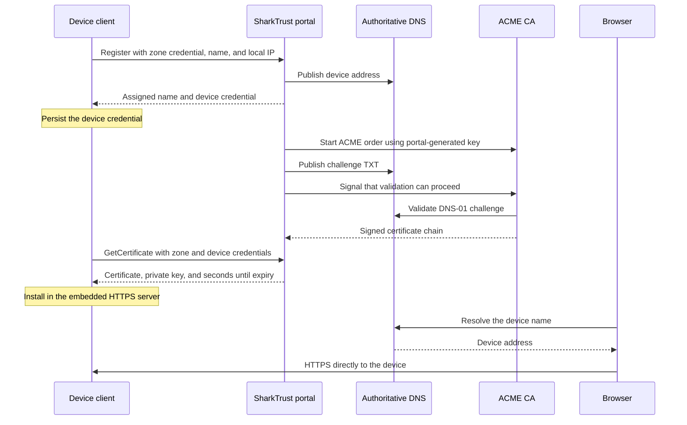

# SharkTrust architecture

[Manual index](README.md) | [Device protocol](SharkTrust-Protocol.md) | [Stored data](data-structures.md)

SharkTrust combines the Domain Name System (DNS) with certificate automation for
embedded web servers. DNS connects a device name to its current address.
Transport Layer Security (TLS) authenticates that name and encrypts the browser's
connection. The certificate authority (CA) signs the certificate after the
portal proves control of the domain using Automated Certificate Management
Environment (ACME).

## Components and responsibilities

| Component | Responsibility |
| --- | --- |
| Device client | Authenticate the portal, register a name/address, save its device credential, and download/install certificate replacements. |
| Embedded web server | Serve the device interface over HTTPS and enforce the product's user authentication and authorization. |
| SharkTrust application | Zone administration, device API, DNS updates, ACME orders, key storage, and certificate scheduling. |
| Mako Server | Execute the Lua/Lua Server Pages application and provide TLS, crypto, SQLite, and ACME engine APIs. |
| BIND9 | Serve the authoritative DNS zones and temporary ACME validation records. |
| SQLite database | Persist zones, devices, users, administrator credentials, and renewal metadata through a serialized writer. |
| SMTP service | Deliver registration, recovery, sensitive-action codes, and operational messages. |

The Ansible installer places application code in `SharkTrust.zip` and persistent
state outside the package. See [installation](installation.md) for the paths and
[operations](operations.md) for maintenance.

## Registration and certificate delivery

The initial download may return `Processing`; the client retries until the
certificate is available. The portal's DNS-01 workflow waits two minutes after
publishing a challenge before continuing validation. ACME work is asynchronous,
and device orders can overlap without removing each other's TXT records.

Only `Register` and `GetCertificate` are required for a minimal client.
`GetCertificate` also updates the device address. Optional commands return the
assigned full name or observed WAN address, or update DNS without fetching a
certificate. The [protocol reference](SharkTrust-Protocol.md) defines these calls.

## DNS and request routing

The parent DNS provider delegates a zone to the portal's configured name servers.
SharkTrust creates its authoritative child zone after registration. The child
contains the zone-apex address for the portal, device address records, and active
ACME TXT challenges. Parent delegation and a working child zone are separate
checks; both are needed after registration.

The same portal can serve multiple web interfaces. Requests for `settings.dn`
open service administration; requests for a registered zone open that zone's
interface. In private mode, the configured LAN IP also opens administration.
The device endpoint is `/device/`. Device-name DNS normally points directly to
the embedded server, so browser traffic to the device does not pass through Mako.

By default, a device publishes its reported local IPv4 address. The protocol
also permits the observed WAN address or both local and WAN records. WAN
publication does not establish port forwarding or a tunnel. Publishing both
does not ensure clients select a reachable address. See the
[address-mode contract](SharkTrust-Protocol.md#address-publication).

The anonymous zone page filters devices by the browser's source address as
observed by the portal. Signed-in users can view all devices in their zone.
Source-address grouping is a convenience, not a network isolation mechanism.
Public DNS records and public-CA certificate names are not secret inventory.

## Certificate and storage ownership

The portal generates device private keys, obtains certificates, and stores both
under the selected CA profile. The device downloads its own key and certificate
over verified TLS. Existing keys are reused for renewal. This is the central
trust decision in a SharkTrust deployment: the portal and its backups have
access to the device's TLS private key.

The portal uses ACME Renewal Information (ARI) when available and persists the
selected renewal time in SQLite. Without usable ARI it uses the certificate's
actual lifetime. Renewal at the portal and installation at the device are
separate operations; a device must keep polling. See
[certificate lifecycle](operations.md#certificate-lifecycle).

There is one serialized SQLite writer for transactions and short-lived read
connections. Browser/device write responses follow a database commit. DNS
publication follows the record change; a failed DNS reload can therefore leave
a committed change temporarily unpublished. The portal queues DNS retries.
Its [data model](data-structures.md) replaces the older per-record JSON files.

## Trust boundaries

- The client verifies the portal certificate's chain, hostname, and validity
  before sending zone or device credentials. Provision trusted CA roots and a
  usable clock as part of the product integration.
- The shared zone credential authorizes enrollment; a device credential selects
  an existing device within that zone. These are bearer credentials, so protect
  them in firmware, persistent storage, and diagnostics.
- Credential obfuscation in `getzkey.ch` is not hardware-backed key protection.
  The supplied test-zone header is public; use a privately controlled zone for
  your product.
- The portal's root service, database, certificate files, SMTP settings, and
  backups require controlled administrative access. The installer keeps
  private files restricted while making generated DNS records readable by BIND.
- Email verification protects zone-key disclosure and generated-header download.
  Browser state-changing requests also require session-bound CSRF tokens.
- Removing a registration prevents use of that device credential. It does not
  revoke an already-issued certificate at the CA or erase a device's copy.

Public trust depends on the selected CA and the client trust store. A private
portal address does not change that relationship; see
[on-premises installations](on-premises.md).
