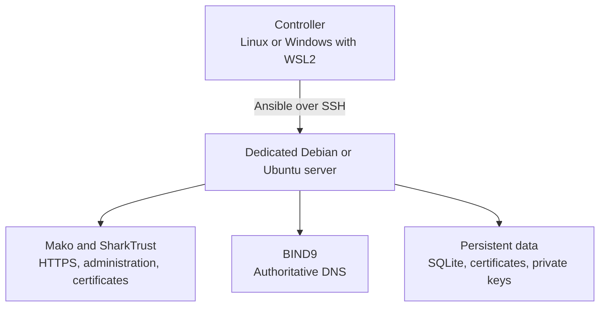

# Install the SharkTrust portal with Ansible

[Manual index](README.md) | [Configuration reference](portal.md) | [Troubleshooting](troubleshooting.md)

This guide installs a self-hosted SharkTrust portal on a dedicated Linux server.
Ansible runs on your **controller** computer and uses SSH to configure the
**target** server. The target runs Mako Server, the SharkTrust application,
SQLite storage, and the BIND9 DNS service.

The installer creates `/opt/SharkTrust` and a systemd service. **The portal stays
stopped by default**, giving you time to set its administrator credentials.
BIND is configured and started during installation.



## 1. Prepare the server and service names

Use an x86-64 Debian or Ubuntu server with systemd, Python 3, and SSH access.
Choose a supported distribution whose target Python version is supported by
your Ansible release.
Use a deployment account with passwordless sudo, or create one with the optional
preparation playbook below. The portal runs as root in the supplied service
because it manages BIND configuration and privileged ports.

Choose a dedicated machine or VM. SharkTrust owns `/etc/bind/named.conf.local`
and its generated zones; do not install it over a shared DNS server. Ports 80
and 443 must be available to Mako, and TCP/UDP port 53 to BIND.

At your existing DNS provider, create these records using your server's public
IPv4 address. `203.0.113.10` is a documentation address, not a working server:

| Type | Full name | Value |
| --- | --- | --- |
| A | `portal.example.com` | `203.0.113.10` |
| A | `ns1.example.com` | `203.0.113.10` |
| A | `ns2.example.com` | `203.0.113.10` |

Keep these names in DNS managed independently of SharkTrust. You will delegate
device zones later. Two NS names pointing at one machine do not provide server
redundancy; the installer deploys one authoritative server, not a replicated pair.
Do not advertise AAAA records unless the corresponding IPv6 services are reachable.

For a public server behind network address translation (NAT), arrange forwarding
and use its public IPv4 address for `settingsip`. For intentional private portal
operation, read [on-premises installation](on-premises.md) before continuing.

Verify all three names from the controller and target:

```bash
# These should resolve to the intended server address.
getent ahostsv4 portal.example.com
getent ahostsv4 ns1.example.com
getent ahostsv4 ns2.example.com
```

The target needs a working recursive DNS resolver for Internet lookups.
SharkTrust's BIND configuration is authoritative-only, with recursion disabled;
it must not be the host's sole resolver for unrelated names.

### Network access

Apply these rules in both the server firewall and any cloud/router firewall.
The main installer does not enable a firewall; optional preparation tasks can
configure UFW.

| Direction at the target | Port/protocol | Purpose |
| --- | --- | --- |
| Inbound from administrators | SSH port, normally TCP 22 | Deployment and maintenance. |
| Inbound from DNS clients and CAs | UDP and TCP 53 | Authoritative DNS and DNS-01 certificate validation. Both protocols are needed. |
| Inbound | TCP 80 | HTTP-01 validation of public portal service names and HTTPS redirects. |
| Inbound | TCP 443 | Portal web interface and device API. |
| Outbound | UDP and TCP 53 | Recursive resolution and direct DNS tracing to authoritative servers, including the registration check's initial query to `8.8.8.8`. |
| Outbound | TCP 443 | ACME, Git/release downloads, and optional Microsoft sign-in. |
| Outbound | Configured SMTP TCP port | Registration, verification, and operational email. |
| Outbound | Ports used by OS package repositories | Installation and system updates, commonly TCP 80/443. |

Only the portal's authoritative DNS needs to be publicly reachable for device
DNS-01 validation. The CA does not connect to the device web server.

## 2. Prepare the Ansible controller

Use Linux, or **WSL2 on Windows**. Run the Bash commands below inside Linux,
not in PowerShell. A fresh Ubuntu 24.04 controller supplies Python 3.12; an older
distribution needs a separately installed Python version supported by the
Ansible release you choose. The local validation environment uses Ubuntu-22.04
WSL2 with Python 3.12 and ansible-core 2.21.3.

On Windows, check the WSL version and open your WSL2 distribution:

```powershell
# Use your installed WSL2 distribution name from this list.
wsl --list --verbose
wsl -d Ubuntu-22.04
```

Install Ansible in an isolated Python environment. These commands assume
`python3.12` is already installed; see the
[Ansible installation guide](https://docs.ansible.com/projects/ansible/latest/installation_guide/index.html)
for supported Python versions and other controller systems.

```bash
# Run on the controller, not on the portal server.
sudo apt-get update
sudo apt-get install -y pipx sshpass git zip
pipx install --python python3.12 --include-deps ansible
pipx ensurepath
export PATH="$HOME/.local/bin:$PATH"
ansible-playbook --version

# Use a Linux home directory for the checkout and private deployment files.
mkdir -p "$HOME/src"
cd "$HOME/src"
git clone https://github.com/RealTimeLogic/SharkTrust.git
cd SharkTrust/ansible
ansible-galaxy collection install -r NewMachine/requirements.yml
ansible-galaxy collection install -r SharkTrust/requirements.yml
```

All subsequent controller commands assume `$HOME/src/SharkTrust/ansible` unless
another directory is stated. Local archive paths must be Linux paths, such as
`/home/operator/releases/mako.tar.gz`, not Windows drive paths.

Verify the target's SSH fingerprint through your VPS provider or server console,
then connect once with SSH. Host-key checking remains enabled. Your controller
needs an SSH key; create one with `ssh-keygen -t ed25519` if necessary, and keep
the private key on the controller.

## 3. Optional: create the deployment account

Skip this section if you already have SSH-key login and passwordless sudo.
Otherwise review [NewMachine/vars.yaml](../ansible/NewMachine/vars.yaml).
Its `onlineuser` string defaults to `rtl`; change it if you want a different
deployment account.

```bash
# Run from the controller's SharkTrust/ansible directory.
# This wrapper asks for the target's initial root password.
bash NewMachine/main.sh portal.example.com

# Verify the new account before changing root SSH access.
ssh rtl@portal.example.com sudo -n true
```

The wrapper selects `~/.ssh/id_ed25519.pub` or `~/.ssh/id_rsa.pub`. Supply another
public-key path as its second argument. It bootstraps Python if necessary,
installs sudo and CA certificates, creates the account, and grants passwordless
sudo. If the provider uses an existing key-only administrator instead of a root
password, use that account and skip this wrapper.

The optional distribution upgrade, automatic updates, UFW firewall, fail2ban,
root SSH restriction, and conflicting-package removal are **all disabled by
default**. Review the [preparation options](portal.md#server-preparation-options)
before enabling them. Installing required packages can still upgrade BIND
dependencies and restart DNS.

## 4. Select a compatible Mako runtime

Obtain a trusted Linux x86-64 Mako release archive containing `mako` and its
matching `mako.zip` at the archive root. You need BAS 6375 or newer and current
resources with the ACME engine and ARI APIs; the version number alone is not
sufficient. The installer checks the required APIs without starting listeners
or making certificate requests.

No runtime download URL is selected by default. Supply either a controller-local
tar.gz archive or an HTTPS release URL, together with its SHA-256 digest. Obtain
the release from your established Mako distribution channel or
[Real Time Logic](https://realtimelogic.com/contactus/).

```bash
# Inspect and hash a release you have obtained from a trusted source.
tar -tzf /home/operator/releases/mako.linux-x64.tar.gz
sha256sum /home/operator/releases/mako.linux-x64.tar.gz
```

The listing must include `mako` and `mako.zip`, not only a containing directory.
A checksum verifies the selected bytes; when downloading a release, compare it
with the digest supplied by its trusted publisher.

## 5. Configure your installation

Keep site settings and SMTP credentials outside the repository. For example,
create `$HOME/.config/sharktrust/portal-vars.yaml` with mode `0600`, in a directory
with mode `0700`. Review the defaults in
[SharkTrust/vars.yaml](../ansible/SharkTrust/vars.yaml); extra variables override
those defaults.

Use this as the content of your private variables file, replacing every example
value and the checksum placeholder:

```yaml
# Site-specific settings, kept outside Git on the Ansible controller.
settingsdn: "portal.example.com"
settingsns1: "ns1.example.com"
settingsns2: "ns2.example.com"
settingsip: "203.0.113.10"  # Public mode; use the LAN IP for private mode.

emailserver: "smtp.example.com"
emailport: 465
emailconsec: "tls"
emailuseauth: true
emailuser: "sharktrust@example.com"
emailpassword: "REPLACE_WITH_SMTP_CREDENTIAL"
emailfrom: "sharktrust@example.com"
emailto: "operations@example.com"

# A Linux path on this controller; a download URL is an alternative.
mako_local_archive: "/home/operator/releases/mako.linux-x64.tar.gz"
mako_archive_checksum: "sha256:REPLACE_WITH_64_HEXADECIMAL_CHARACTERS"

# Master is convenient for evaluation; pin a reviewed commit for repeatability.
GitSharkTrustVersion: "master"
settingsacmeproduction: true
start_portal: false
replace_mako_conf: false
```

`emailto` is one operational contact address and is also used for ACME account
registration. SMTP must work for zone registration, account recovery, and
sensitive credential downloads. For port 587, use your provider's settings,
typically `emailconsec: "starttls"`.

Production is the default so ordinary browsers can validate the resulting
certificates. For repeated issuance testing, use a separate test installation
and `settingsacmeproduction: false`; staging certificates are not publicly
trusted. The [configuration reference](portal.md) explains alternative CAs,
runtime download URLs, and all installer settings.

You can encrypt the private variables file using `ansible-vault encrypt` and
add `--ask-vault-pass` to the install command. Do not place SMTP passwords in
tracked files or in command-line `-e password=...` arguments.

## 6. Run the installer

First parse both playbooks locally:

```bash
# From SharkTrust/ansible on the controller; these do not connect to the target.
ansible-playbook -i localhost, --syntax-check NewMachine/main.yaml
ansible-playbook -i localhost, --syntax-check SharkTrust/main.yaml
```

Then deploy. Replace `rtl` with your SSH deployment account:

```bash
# This command changes the target server.
bash SharkTrust/main.sh portal.example.com rtl \
  -e @"$HOME/.config/sharktrust/portal-vars.yaml"
```

The wrapper supplies the single-host inventory and playbook configuration. It
forwards additional Ansible options, such as `--ask-vault-pass` or `--private-key`.
Ansible reads the controller's variables file, while the target checks out
SharkTrust from GitHub at `GitSharkTrustVersion`. Uncommitted controller changes
are not deployed by that Git path.

The playbook installs the DNS and system dependencies, checks BIND configuration
and permissions, packages the portal, validates the Mako runtime, and installs
the service. Required packages include `bind9`, `bind9-utils`, `bind9-dnsutils`
(`dig`), `ca-certificates`, `coreutils`, `git`, `libc-bin`, `python3`, `tar`,
`unzip`, and `util-linux`.

Success ends with no failed tasks. At this point BIND should be active and
SharkTrust stopped. Inspect failures before continuing; a partially completed
playbook is not an activated portal.

| Installed path | Purpose |
| --- | --- |
| `/opt/SharkTrust/SharkTrust.zip` | Application package built from `www`. |
| `/opt/SharkTrust/mako.conf` | Private runtime configuration. |
| `/opt/SharkTrust/data`, `/opt/SharkTrust/cert` | Persistent database, credentials, certificates, and ACME accounts. |
| `/opt/SharkTrust-source` | Default target-side Git checkout. |
| `/usr/local/bin/mako`, `/usr/local/bin/mako.zip` | Matched runtime executable and resources. |
| `/etc/systemd/system/SharkTrust.service` | Portal service unit. |
| `/etc/bind/zones`, `/etc/bind/named.conf.local` | DNS files managed by SharkTrust. |

## 7. Set administrator credentials and start

Run these commands **on the target server**:

```bash
# Set or reset the portal account while the normal service is stopped.
sudo systemctl stop SharkTrust
cd /opt/SharkTrust
sudo /usr/local/bin/mako -c /opt/SharkTrust/mako.conf \
  -credentials 'admin@example.com:REPLACE_WITH_YOUR_PASSWORD'

# Run this only after the credential command succeeds and exits.
sudo systemctl enable --now SharkTrust
sudo systemctl status SharkTrust named --no-pager
```

Use an 8-1024 byte password and quote it for your shell. The credential command
prints a confirmation, saves a salted password hash, and exits with status 0.
It does not run normal DNS or certificate work. Use it without `-s` or `-d`;
never put `-credentials` in the service unit. The argument can be visible in
process listings and shell history. See the
[credential reference](portal.md#set-or-reset-the-portal-administrator) for the
full format and reset behavior.

## 8. Verify the installation

On the target, inspect service logs and DNS control:

```bash
# These checks do not request new certificates themselves.
sudo journalctl -u SharkTrust -u named -n 100 --no-pager
sudo tail -n 100 /var/log/mako.log
sudo rndc status
sudo runuser -u bind -- named-checkconf -z
dig -v
```

On a public deployment, SharkTrust obtains its service certificate using
HTTP-01 on port 80. HTTPS may initially serve Mako's fallback certificate.
Wait for successful issuance and the `Serving TLS certificates for ...` log,
then verify from the controller:

```bash
# Install curl on the checking computer if it is not already available.
# Certificate verification is intentionally enabled.
curl --fail --show-error --silent --output /dev/null https://portal.example.com/
```

Open that URL in a browser, sign in, and use **Test email**. Confirm both SMTP
acceptance and receipt in the intended inbox. Open **Certificate service** to
check the CA directory/environment and pending retries. A running process or an
account email alone does not prove that DNS and certificate issuance succeeded.

Next, [register your first zone](user-guide.md#register-a-zone), verify its
authoritative DNS over UDP and TCP, and fetch a device certificate using the
[C examples](../examples/README.md#use-your-own-zone-optional). Verify browser
HTTPS from the device's network and that a client restart reuses its registration.
Test reboot recovery in your maintenance window before relying on unattended
operation.

For subsequent installer runs, remember that `start_portal: false` also stops
and disables an existing portal. Set it to `true` when an upgrade should leave
the service running; a saved administrator record is required. Follow
[operations and upgrades](operations.md) to preserve state and configuration.
