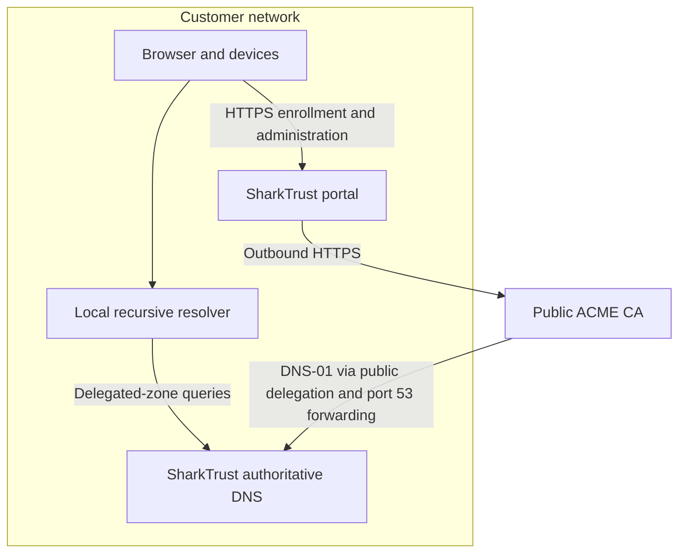

# Run SharkTrust on premises

[Manual index](README.md) | [Installation](installation.md) | [Configuration](portal.md)

An on-premises portal keeps zone administration, device records, certificate
storage, and authoritative DNS on a server in your network. It uses the same
device protocol as a public portal. Local hosting and certificate trust are
separate choices: public certificates still require public CA validation;
private certificates require trust configuration on the clients.

## Plan the addresses and DNS paths

Give the server a stable LAN IPv4 address. Set `settingsip` in Ansible, or
`settings.ip` in `mako.conf`, to that address. SharkTrust recognizes
`10.0.0.0/8`, `172.16.0.0/12`, and `192.168.0.0/16` as private mode.

```yaml
# Overrides for the main Ansible playbook; supply SMTP and runtime settings too.
settingsdn: "portal.example.com"
settingsns1: "ns1.example.com"
settingsns2: "ns2.example.com"
settingsip: "192.168.1.20"
```

`settingsdn` is still a hostname. Arrange for local clients to resolve it to
the LAN server. Name-server names retain their publicly delegated names; the
portal publishes each registered zone's apex with the private portal address.
Device names resolve to the addresses supplied by devices by default.



BIND is authoritative-only, not a general recursive resolver. Configure your
existing local recursive resolver with appropriate conditional forwarding or
local delegation for the SharkTrust zones. That lets local DNS continue to
resolve those zones when the WAN is unavailable. Merely listing this BIND
server as every client's sole DNS resolver breaks unrelated name lookups.

The portal's registration check currently traces **public** delegation, starting
at `8.8.8.8`. Internal-only delegation is insufficient for that workflow, even
if a private CA could validate an internal name. Public names resolving to
private addresses may also need a narrowly scoped exception in a resolver's
DNS-rebinding protection policy. Check that policy with the network operator.

## Using a public certificate authority

For each zone, use a registered public domain and delegate it to the configured
name servers. Publish reachable public addresses for those name servers and
forward **both UDP and TCP port 53** to the portal's BIND server. Allow outbound
DNS tracing and HTTPS to the CA. This supports DNS-01 validation without making
device web servers publicly reachable.

A router must provide a working public route for those DNS queries; an
installation behind carrier-grade NAT without inbound forwarding does not
meet this requirement. Local DNS queries must also work, through local
forwarding/delegation or suitable NAT routing.

For a public-facing portal hosted on a NAT VM, use the public IPv4 address for
`settingsip` and forward ports 53, 80, and 443 instead. That selects public mode,
including HTTP-01 issuance for the service hostname. A VM having a private
network interface does not by itself mean you want private portal behavior.

## Bootstrap administration and trusted HTTPS

In private mode, the administrator can initially open `http://192.168.1.20/`.
This exception applies only when the request targets the configured private IP
and comes from a private or loopback address. Use it on an isolated management
network: HTTP does not encrypt passwords. Devices always require TLS.

Private mode does **not** automatically request HTTP-01 certificates for
`settings.dn` or the static name-server hostname. It still loads their saved
certificates from the selected CA profile. Registered zone apex names and device
names use DNS-01 and are managed automatically.

There are two ways to give clients a trusted portal endpoint:

1. **Use the registered zone's HTTPS hostname for device API requests.** Complete
   registration through the local administration interface, then let the portal
   issue the zone-apex certificate through DNS-01. Verify
   `https://devices.example.com/` from the device network and configure the client
   service hostname as `devices.example.com`. The `/device/` endpoint is served
   there too. This is the portal's zone page and API, not a device's web server.
2. **Provision a certificate for the service hostname separately.** Install a
   matching private key and certificate chain in that hostname's selected
   [certificate profile](data-structures.md#certificate-profiles), then restart
   SharkTrust. Provision and renew this static certificate with your established
   certificate-management process; private mode does not renew it automatically.
   The hostname must match `settings.dn`, and its issuer must be trusted by clients.

The second option is also needed for trusted HTTPS at the central administration
hostname. Use the selected directory URL and production/staging flag to identify
the correct profile; changing them selects a different certificate store.
Protect the key and preserve the complete PEM chain. Do not disable client
certificate verification to work around an untrusted endpoint.

## Using a private ACME CA

Select the CA's directory in [portal configuration](portal.md#select-another-certificate-authority).
It must support the required ACME validation methods and ordinary account
creation; the current engine does not support External Account Binding.
Install the necessary trust in Mako for its outbound CA connection and in the
browsers/devices that connect to certificates issued by that CA.

The current public-delegation registration check still applies. This installer
does not provide an air-gapped or internal-name-only enrollment mode.

## What continues during an Internet outage

An installed, unexpired device certificate can continue to serve local HTTPS.
Local DNS can continue when the LAN resolver can reach the authoritative server
without depending on WAN resolution. Devices can contact a locally reachable
portal and retrieve credentials already stored there.

Public CA issuance, renewal, public delegation tracing, and external SMTP or
Microsoft sign-in require their external services. A device that keeps its
certificate only in RAM also depends on reaching the portal again after reboot.
Include DNS, portal availability, device storage, and certificate lifetime in
your offline operating plan; local portal placement alone is not an offline
certificate service.
