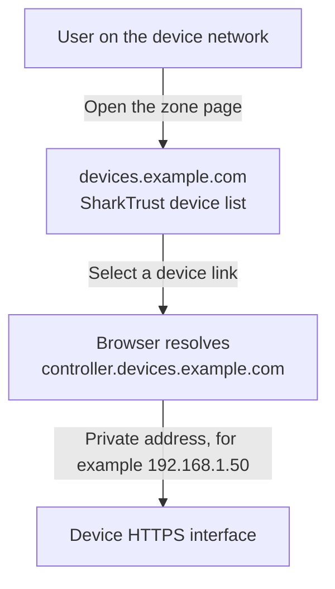

# SharkTrust user manual

[Manual index](README.md) | [Client integration](../examples/README.md) | [Troubleshooting](troubleshooting.md)

Use SharkTrust to give your embedded web servers recognizable names and trusted
HTTPS certificates. A **zone** is a domain managed by the portal, such as
`devices.example.com`. Each device receives a name within that zone, such as
`controller.devices.example.com`.

A manufacturer can share one product zone across customer installations, or
customers can register their own zones. The device's zone credential selects
its namespace. Your product can embed that credential or let a customer
configure it. To evaluate the client without managing a zone, start with the
[bundled shared test zone](../examples/README.md#try-the-shared-test-zone).

## Understand the three web addresses

| Address | What opens there | Who uses it |
| --- | --- | --- |
| `https://portal.example.com/` | Registration and service administration. | New zone owners and the portal administrator. |
| `https://devices.example.com/` | Device discovery and management for one zone. | Device users, the zone owner, and invited users. |
| `https://controller.devices.example.com/` | The embedded device's own web server. | Users who can reach that device's network address. |

The zone address resolves to the portal. A device address normally resolves to
the device's private IPv4 address. A publicly trusted certificate authenticates
the device's DNS name, even though the browser reaches it on a private network.
Open the device by its DNS name; an IP-address URL does not match that certificate.



## Register a zone

You need a domain you control, access to its DNS settings, and a working company
email address. The registration form rejects providers on its free-email
provider list. Obtain the authoritative name-server names from your portal
operator; a self-hosted portal must first complete [installation](installation.md).

### Delegate the domain

For a subdomain, add two NS records at the **parent DNS provider**. To delegate
`devices.example.com`, edit the `example.com` DNS zone:

| Type | Name in the parent's DNS editor | Target |
| --- | --- | --- |
| NS | `devices` | `ns1.example.com.` |
| NS | `devices` | `ns2.example.com.` |

For Real Time Logic's test portal, the targets are `ns1.realtimelogic.com.` and
`ns2.realtimelogic.com.`. Use your own subdomain in place of `devices`; the bundled
`st.sharkssl.com` test zone is already registered.

For a whole domain, change its delegation through the domain registrar instead.
That transfers authority for the whole domain to SharkTrust, so use a dedicated
domain or subdomain that does not also need unrelated mail or website records.
The portal regenerates its zones and is not a general-purpose DNS record editor.
Keep the portal's service and name-server names outside the delegated device zone.

Check the parent delegation from Linux or WSL:

```bash
# Substitute your zone. Keep the full output when diagnosing failures.
dig -r -4 @8.8.8.8 +trace +nodnssec +time=2 +tries=1 NS devices.example.com
```

Look for the parent returning both expected NS names for your exact zone.
Before registration, the final query to the child server can fail because the
portal has not created that zone yet. The parent delegation is what the
registration check uses. There is no fixed propagation delay; use the observed
records. WHOIS is not a check for subdomain delegation. `-4` selects IPv4 for
the lookup itself and does not require IPv6 records for your domain.

### Complete registration

1. Open the service hostname, for example
   [Real Time Logic's test portal](https://sharktrust.realtimelogic.com/).
2. On **Register**, enter your zone domain and company email address, review
   the service agreement, and choose **Accept and Sign Up**.
3. Open the **SharkTrust E-Mail Validation** email. Visit its validation URL
   and paste the validation key into the form. The key expires after one hour;
   restarting the portal also invalidates outstanding registration keys.
4. After delegation is confirmed, set and confirm the zone-owner password
   (at least eight characters). Your email address is the owner username.
5. Save the **SharkTrust Account Information: &lt;zone&gt;** email and its zone key
   in private storage. The portal sends this notice after a short delay; it is
   not proof that certificate issuance has completed.
6. Open `https://devices.example.com/` after DNS and certificate provisioning
   complete. Sign in with the zone-owner account using **Login**.

The account email includes the zone's HTTPS address and its **64-character
hexadecimal zone key**. You need that key for client enrollment and owner
password recovery. If the zone URL has a certificate warning, ask the operator
to inspect [certificate and DNS status](troubleshooting.md#certificate-warnings).

## Connect your first device

Open **Client integration** while signed in as the owner or a zone administrator.
The portal sends a verification code to the **zone owner's** mailbox. Enter the
code in the initiating session to download `getzkey.ch`, the generated C header
containing the zone credential. Alternatively, **Settings** offers email
verification to reveal the plain zone key.

Each code expires in ten minutes and allows five attempts. Requests are limited
to one per minute and five per hour per session. A successful code grants one
use of the selected action within one minute. Download and save the file when
the action completes; a later download needs another verification.

Follow [use your own zone](../examples/README.md#use-your-own-zone-optional):
replace the test `getzkey.ch`, rebuild, and run in a fresh private working
directory. Keep the service hostname unchanged when using another zone on the
same portal. If your product allows customer-selected zones, provide a way to
configure the corresponding credential instead of hard-coding a manufacturer zone.

The device registers its requested name and IPv4 address. When a name is in use,
the portal adds a numeric suffix. The device must retain the assigned name and
its separate **20-character device key**; the examples save that key in
`DEVICE.KEY`. Do not clone a registered device's key onto other devices.

Initial issuance takes time. A `Processing` response tells the client to poll
again; the examples wait 70 seconds. Once downloaded, the certificate and its
private key must be installed in the device web server. See the client guide
for PEM files, SharkSSL format, polling, and platform-specific integration work.
The generated header is obfuscation, not protection against credential extraction.
Keep your own zone's header private; the bundled test header is intentionally public.

## Find and manage devices

The zone's **Devices** page lists devices with the same source address as your
browser, as seen by the portal. For a public portal this commonly groups devices
behind the same router. **Manage**, available after sign-in, lists all devices
in the zone grouped by their observed source address.

This grouping is a discovery convenience, not proof of membership in a private
network. VPNs, shared Internet gateways, and proxies can change which devices
appear. On premises, a direct browser connection and a device connection may
have different source addresses. Use **Manage** to inspect all registrations.
The device web server still needs its own authentication and access rules.

Expand **Details** to see the last address/certificate contact, certificate
expiration, and device description. These values describe portal records, not
a continuous health check or proof that the device installed the latest certificate.
An operator or administrator can select **Remove device** and confirm removal.

Removal deletes the registration, DNS entry, and stored certificate material,
and invalidates the device credential. It does not revoke a certificate already
issued by the CA or erase a downloaded key from a device. A client still holding
the zone credential can register again. Decommission the device or remove its
enrollment credential when appropriate.

### Clean up inactive devices

Devices are not automatically deleted after 90 days. Open **Inactive devices**,
enter a whole number of days from 1 to 36500 (initially 90), and select
**Preview devices**. Review the list before acknowledging removal.

A preview expires after five minutes. Removal rechecks activity and retains
devices that contacted the portal after the preview. An old preview or expired
session requires a fresh preview. Cleanup has the same credential and
certificate effects as individual removal.

## Add users and assign roles

The zone owner and portal administrator have administrative access. A zone
administrator can open **Users and sign-in** to add or update other users:

| Role | Permissions |
| --- | --- |
| Viewer | View all registered devices and details. |
| Operator | Viewer access plus device removal and inactive-device cleanup. |
| Zone administrator | Operator access plus user management, sign-in settings, zone credentials, and zone termination. |

Enter the user's email address and role. For local password sign-in, set an
8-1024 byte password. For Microsoft sign-in, supply the user's Entra object ID
and configure Entra below. A new user needs at least one of these sign-in methods.
The portal does not send the new local password; arrange its delivery separately.

To update a user, enter the same email address. A blank password retains the
saved password. A blank Entra object ID disables Microsoft sign-in for that
user, so retain it when only changing a role. Usernames are normalized to
lowercase. Password/role changes and removal invalidate that user's existing
sessions. Sessions also expire after 30 minutes of inactivity.

## Optional Microsoft Entra sign-in

Register a single-tenant Web application in Microsoft Entra, using
`https://devices.example.com/sso` as its redirect URI. Substitute the zone
hostname, not the central service hostname. The zone must already have working
HTTPS and the portal needs outbound access to Microsoft endpoints.

In **Users and sign-in**, enable Microsoft Entra sign-in and save:

| Field | Type and requirement |
| --- | --- |
| Tenant ID | Required UUID string for the tenant. |
| Application (client) ID | Required UUID string for the Web application. |
| Client secret Value | Required nonempty string, at most 512 bytes. Use the secret's Value, not its ID; blank retains a saved secret. |
| Client secret expiration | Required date in `YYYY-MM-DD` format. |
| User object ID | UUID string in each allowed user's record; required for that user's Entra sign-in. |

Only explicitly added users whose email and object ID match can sign in.
Entra does not automatically enroll users or grant administrator rights; roles
come from SharkTrust. A local account remains usable when it has a saved local
password, even if Entra is unavailable. Keep the owner's recovery details.

The portal emails the owner about client-secret expiration or rejection.
Replace the secret in **Users and sign-in** before it expires; the saved date
drives reminders and must match the date at Microsoft. Secrets are not returned
in forms. Protect database backups because they contain this service credential.

## Recover access

On the zone's **Login** page, select **Forgot account?**. Enter the owner's email
address, then provide the emailed security code, the saved zone key, and a new
matching password. The code expires after ten minutes or five failed attempts.
This flow resets the original owner account, not an added user's password.
For an added user, ask a zone administrator to update the user record.

The portal administrator resets the service account using
[`mako -credentials`](portal.md#set-or-reset-the-portal-administrator).
If the owner has lost the zone key or cannot receive email, contact the portal
operator; there is no email-only owner recovery flow.

## Terminate a zone

In **Settings**, **Terminate Account** asks you to type `yes`. It removes the
zone, its users and device records, and its stored certificate material. A portal
administrator can also terminate a zone from the service's **Manage** page.
This is not a temporary pause. Previously issued certificates are not revoked
at the CA. Update or remove the parent delegation when retiring the zone.
